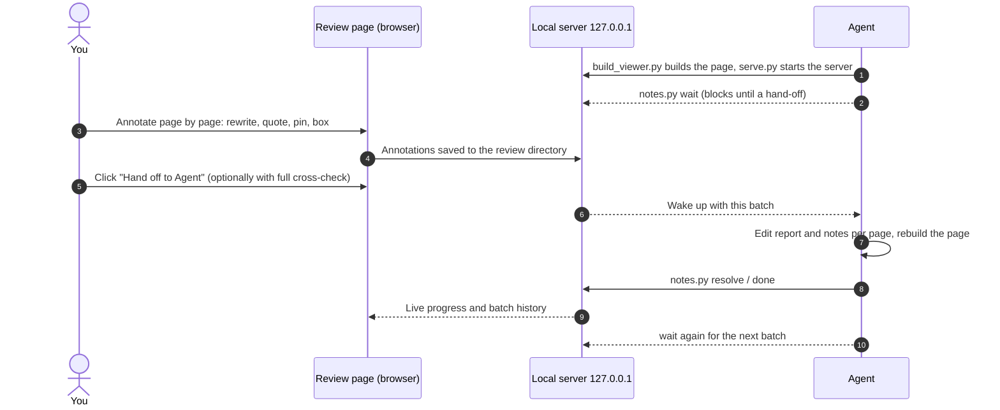

<p align="center">
  <a href="README.md">简体中文</a> · <b>English</b>
</p>

<p align="center">
  
</p>

<p align="center">
  <b>A local review workbench</b> that puts slide-style reports and speaker notes side by side, lets you annotate page by page in the browser, and hands the whole batch to an agent to apply.
</p>

<p align="center">
  
  
  
  
  
</p>

<p align="center">
  <a href="#why">Why</a> ·
  <a href="#features">Features</a> ·
  <a href="#workflow">Workflow</a> ·
  <a href="#quick-start">Quick start</a> ·
  <a href="#security-and-privacy">Security</a> ·
  <a href="#project-layout">Layout</a> ·
  <a href="#development">Development</a>
</p>

<br>

<p align="center">
  
  <br>
  <sub>The review page: the report on the left, where you can drop pins and drag regions; speaker notes and this page's annotations on the right. The interface is in Chinese; all data shown is fictional.</sub>
</p>

## Why

Reviewing a deck of a few dozen pages usually means screenshots, red ink, chat messages, and then retelling every comment to whoever, or whichever agent, does the edits. Comments get scattered, page numbers drift, the report gets fixed but the speaker notes do not, and nobody can say which comments are done.

annotation-everything keeps that whole loop in one local page:

- **Comments stay where they belong.** Each annotation is tied to a page, a quoted passage, or a spot on the report, so the agent gets structured feedback instead of a paraphrase.
- **Both sides change together.** Report and speaker notes are matched page by page; editing one side flags the matching sentence on the other. The agent applies changes per page and rebuilds the review page.
- **Every batch is on record.** Each hand-off becomes a batch, and every annotation carries a status and a resolution summary you can look back on.
- **Nothing leaves your machine.** The server listens on `127.0.0.1` only, makes no network calls, sends no telemetry, and writes annotations to a review directory you choose.

## Features

<table>
  <tr>
    <td width="50%" valign="top">
      <h4>✍️ Text-level annotations</h4>
      Select text in the report or the notes to delete it, rewrite it, or quote it in a comment. When the other side has a matching sentence on the same page, you are prompted to change both.
    </td>
    <td width="50%" valign="top">
      <h4>📍 Mark up the report</h4>
      Click to drop a pin, drag to box a region. Marks can be moved and resized, and exports carry their coordinates relative to the page.
    </td>
  </tr>
  <tr>
    <td valign="top">
      <h4>🤖 Hand off to an agent</h4>
      Submit the whole batch in one click. The agent waits with <code>notes.py wait</code>, wakes up, edits page by page, rebuilds the page, and resolves each annotation while the page shows live progress.
    </td>
    <td valign="top">
      <h4>🔍 Full cross-check</h4>
      Optionally ask the agent to cross-check the entire report and notes for consistent figures, definitions and wording, fix what the source supports, and list what still needs your call.
    </td>
  </tr>
  <tr>
    <td valign="top">
      <h4>🧭 Draft, then review</h4>
      An optional two-stage flow: one model drafts the edits, a stronger model reviews them, or the batch stops at review for you to decide. Every annotation keeps a trail of what was done.
    </td>
    <td valign="top">
      <h4>🧩 Skills and standing skills</h4>
      Discovers the Claude Code and Codex skills on your machine, searches them by name and description, and suggests them from the review context. Standing skills apply to every annotation within their scope.
    </td>
  </tr>
  <tr>
    <td valign="top">
      <h4>🗂️ Batch history</h4>
      See how many annotations each hand-off resolved and what was done. Reopening the page tells you where you left off.
    </td>
    <td valign="top">
      <h4>🔤 PPTX font check</h4>
      Before converting a PPTX to images, list its declared fonts and the ones missing locally; after converting, compare against the PDF's embedding and subset evidence so fonts don't silently fall back.
    </td>
  </tr>
</table>

<details>
<summary><b>Export and import annotations</b></summary>
<br>
<p align="center"></p>
When no agent is waiting, copy all annotations and paste them to any agent, or download them as Markdown or JSON and import them later.
</details>

## Workflow



## Quick start

**1. Install the skill**

```bash
tools/install.sh
```

The skill is copied to `~/.claude/skills/annotation-everything`. From then on, ask Claude Code to "review this report and its speaker notes" or say "I'm done annotating, apply my notes", and it enters this loop.

**2. Try it on the bundled sample**

```bash
S=skill/annotation-everything/scripts
export AE_HOME=$(mktemp -d)   # keep the review ledger in a temp dir while trying it out
python3 $S/build_viewer.py --report fixtures/sample/report.html --script fixtures/sample/script.md --out /tmp/ae-demo
python3 $S/serve.py /tmp/ae-demo
```

The review page opens in your browser. Add a few annotations, click **Hand off to Agent** (「交给 Agent」), then in another terminal run:

```bash
python3 $S/notes.py wait /tmp/ae-demo
```

**3. Prepare your own material**

- **Report**: one HTML file where every page is `<section class="page" data-page="N" data-key="unique-key">`.
- **Speaker notes**: Markdown split by `### 第 N 页｜标题` (page N | title), with duration, talking points, transition and likely questions for each page.

See [references/formats.md](skill/annotation-everything/references/formats.md) for the full format (in Chinese).

<details>
<summary><b>Command reference</b></summary>

| Command | What it does |
|---|---|
| `build_viewer.py --report … --script … --out <review-dir>` | Build the review page; `--rebuild <review-dir>` rebuilds with the recorded arguments |
| `serve.py <review-dir>` | Start the local server; each review keeps its own fixed port |
| `serve.py list` / `status` / `forget` | List all reviews on this machine, show one review's status, drop an entry you no longer need |
| `serve.py check` | Run the server's security self-check |
| `notes.py wait` / `claim` | Wait for, or immediately take, a hand-off |
| `notes.py show` / `resolve` / `reopen` | List annotations, mark them resolved, reopen them |
| `notes.py done` / `review` / `diff` | Close the current stage, record a review verdict, show the draft's edits per page |
| `notes.py batches` | Show batch history |
| `notes.py skills` | Show or set the skill catalog and standing skills |
| `check_pptx_fonts.py original.pptx [--pdf converted.pdf]` | Check fonts before and after PPTX conversion |

</details>

## Security and privacy

| Constraint | How |
|---|---|
| Local only | Binds to `127.0.0.1` only, validates the Host header, sends no CORS headers |
| No forged writes | Write requests must come from the same origin with a JSON Content-Type |
| Minimal surface | Serves only `index.html` and `/api/*`; nothing else in the review directory is exposed |
| No third-party dependencies | Runtime uses the Python standard library only; the font check calls the system tools `fc-list` / `pdffonts` and tells you if they are missing |
| Offline | No telemetry; external resources in the report are not loaded, and local images and fonts are inlined |
| Your data stays yours | Annotations and the review page live in your review directory; the local ledger `~/.annotation-everything/` records only IDs, paths and ports |

Run `serve.py check` after any server change; it verifies each of these constraints.

## Project layout

```text
skill/annotation-everything/       the skill itself, copied as a whole on install
├── SKILL.md                       operating guide the agent reads
├── references/formats.md          input and output formats
├── scripts/
│   ├── build_viewer.py            builds the review page index.html and review.json
│   ├── viewer_template.html       review page template (server mode / local file mode)
│   ├── serve.py                   local server: serve / status / list / forget / check
│   ├── notes.py                   annotation CLI: wait / show / resolve / done / review …
│   ├── notes_store.py             annotation store: atomic writes, file locks, operation log
│   ├── ledger.py                  local review ledger: review IDs, directories and ports
│   ├── match.py                   finds matching sentences between report and notes
│   ├── skill_sources.py           discovers local skill directories
│   └── check_pptx_fonts.py        PPTX / PDF font check
└── evals/                         skill-creator test cases
fixtures/sample/                   synthetic sample (fictional data)
tests/                             unit tests and end-to-end browser tests
tools/install.sh                   installs into ~/.claude/skills/
docs/                              ADRs, agent conventions, README images
GLOSSARY.md                        glossary
```

## Development

```bash
python3 -m unittest discover tests                                   # unit tests (stdlib)
uv run --no-project --with playwright python tests/e2e_browser.py   # end-to-end browser tests (local Google Chrome)
python3 skill/annotation-everything/scripts/serve.py check          # server security self-check
tools/install.sh                                                     # sync to ~/.claude/skills/
```

- Tests point the review ledger at a temp directory (`AE_HOME`). When trying things by hand or running evals, `export AE_HOME=$(mktemp -d)` first so throwaway reviews don't land in your real ledger or take its ports.
- The repository holds synthetic samples only. Real material, annotations and review directories never go into the repository or the skill directory.
- [GLOSSARY.md](GLOSSARY.md) defines the terms, [docs/adr/](docs/adr/) records architecture decisions, and [AGENTS.md](AGENTS.md) holds the collaboration conventions (all in Chinese).
