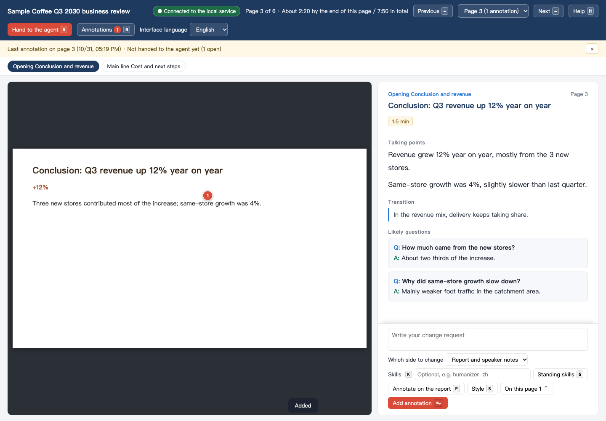
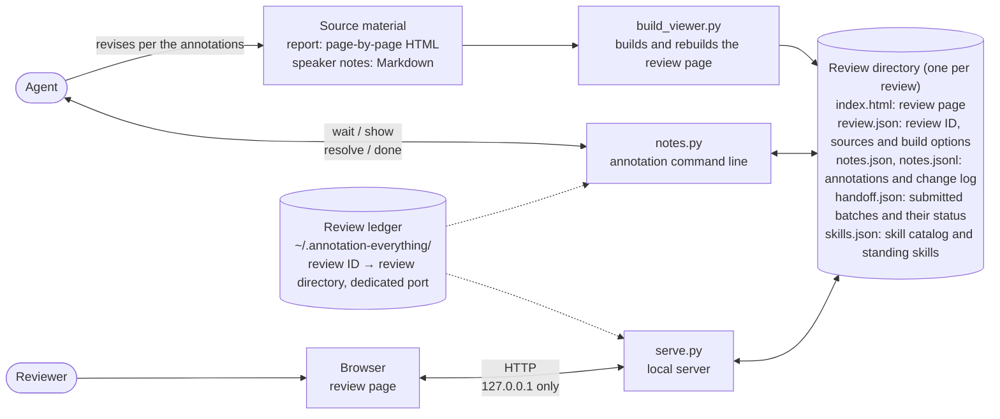
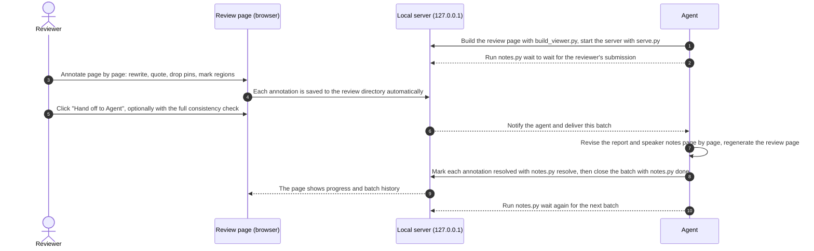
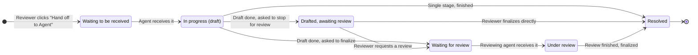
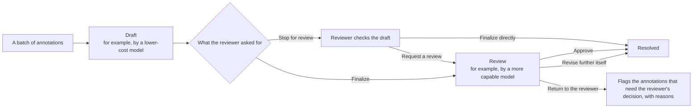

<p align="center">
  <a href="README.md">简体中文</a> · <b>English</b>
</p>

<p align="center">
  
</p>

<p align="center">
  annotation-everything is a review and annotation tool that runs on your machine, packaged as an Agent Skills skill. Any agent that adopts the open Agent Skills standard can use it. It installs into Claude Code's skill directory by default, and <code>--target</code> / <code>--link</code> put it into other skill directories.<br>It puts a page-by-page HTML report and its speaker notes side by side in one page. Reviewers annotate each page in the browser, submit with one click, and an agent revises the report and the speaker notes accordingly.
</p>

<p align="center">
  
  
  
  
  
</p>

<p align="center">
  <a href="#why">Why</a> ·
  <a href="#features">Features</a> ·
  <a href="#how-it-works">How it works</a> ·
  <a href="#quick-start">Quick start</a> ·
  <a href="#security-and-privacy">Security and privacy</a> ·
  <a href="#project-layout">Project layout</a> ·
  <a href="#development">Development</a>
</p>

<br>

<p align="center">
  
  <br>
  <sub>The review page: the report with a pin on the left, speaker notes and annotations on the right. Regions can also be selected by dragging. The interface and material are in English; all data shown is fictional.</sub>
</p>

## Why

Reviewing a presentation of a few dozen pages usually means taking screenshots, marking them up in red, sending messages, and then relaying every comment to whoever revises the material, whether that is a colleague or an agent. That approach has problems: comments end up scattered across places and page numbers get mixed up; the report gets fixed while the speaker notes are forgotten; and by the end, nobody can say which comments have been addressed.

annotation-everything moves this whole process into a single page that runs on your machine:

- **Comments stay where they belong.** Every annotation is tied to a specific page, a quoted passage, or a spot on the report. The agent receives the original annotations with their pages and positions, not a retelling.
- **The report and the notes change together.** Report pages and speaker-note pages are matched one to one. When you select a sentence on one side to request a change, and the same page on the other side has an identical or similar sentence, the page suggests changing both. The agent revises page by page and then regenerates the review page.
- **Every round is recorded.** Each click on **Hand to the agent** creates a batch. Every annotation has a status and a resolution note that you can look back on at any time.
- **Your material never leaves your machine.** The server listens on `127.0.0.1` only, makes no network requests, and sends no usage data. Annotations are saved in a review directory you choose.

## Features

<table>
  <tr>
    <td width="50%" valign="top">
      <h4>✍️ Annotate the text itself</h4>
      Select text in the report or the speaker notes to mark it for deletion, propose a rewrite, or quote it in a comment. When the same page on the other side has a matching sentence, the page suggests changing both.
    </td>
    <td width="50%" valign="top">
      <h4>📍 Mark positions on the report</h4>
      Click to drop a pin, or press and drag to mark a region. Pins and regions can be moved, and regions can be resized. Exported annotations include each mark's position, as percentages measured from the top-left corner of the page.
    </td>
  </tr>
  <tr>
    <td valign="top">
      <h4>🤖 Hand off to an agent in one click</h4>
      The agent runs <code>notes.py wait</code> ahead of time to wait for a submission. When the reviewer clicks <b>Hand off to Agent</b>, the agent receives the batch, revises the report and speaker notes page by page, regenerates the review page, and marks each annotation as resolved. The page shows progress as it happens.
    </td>
    <td valign="top">
      <h4>🔍 Full consistency check</h4>
      An option you can tick when submitting. Besides handling the annotations, the agent checks the entire report and speaker notes for consistent figures, metric definitions and wording, fixes the problems that the source material supports, and lists anything the reviewer needs to confirm.
    </td>
  </tr>
  <tr>
    <td valign="top">
      <h4>🧭 Draft first, then review (optional)</h4>
      Handle a batch in two stages: one model drafts the changes, then a more capable model reviews them. You can also stop after the draft and decide whether to request a review or finalize directly. Every annotation keeps a record of what happened at each stage.
    </td>
    <td valign="top">
      <h4>🧩 Skills and standing skills</h4>
      Finds skills in common local skill directories and plugin caches (<code>~/.claude</code>, <code>~/.codex</code>, <code>~/.agents</code>, and <code>~/.zcode</code>), lets you search them by name and description, and suggests skills based on what is being reviewed. Once a skill is set as a standing skill, the agent calls it first for every annotation within its scope.
    </td>
  </tr>
  <tr>
    <td valign="top">
      <h4>🗂️ Batch history</h4>
      See, for each submission, how many annotations were resolved, who handled each stage, and what was done. When you reopen the page, it tells you which page you were last annotating and whether the agent has finished.
    </td>
    <td valign="top">
      <h4>🔤 PPTX font check</h4>
      Before converting a PPTX file to images, list the fonts it declares and those missing on your machine. After converting to PDF, compare against the fonts embedded in the PDF. This catches cases where a missing font is silently replaced by a different one.
    </td>
  </tr>
</table>

The review page can use Simplified Chinese or English. Pass `--locale auto`, `zh-CN`, or `en` when building; the page can switch language too, and the choice stays in this browser. Annotation text stays as written, and the stored target values `报告`, `讲稿`, and `报告和讲稿` do not change with the language. Omitting `--locale` keeps a new review in Chinese and leaves an existing review on its saved choice. Adding, editing, deleting and reopening annotations, quotes, quick delete and replace, pins and area selection, re-annotating, styling, page numbers, the speaker-notes column, Q&A labels, the help text, tooltips and accessible names all follow the current language, as do the confirmation dialogs. So do the skill box, its suggestions and "Suggested" tag, the empty result, the standing-skill scope labels and add/remove prompts, and the output of `notes.py skills`. Search still matches the skill catalog's original name and description, and the stored scope values `all` / `报告` / `讲稿` / `style` stay unchanged. Exported Markdown can be Chinese or English (following the interface by default); both the page and CLI can import either language. The "Hand to the agent" dialog, submission badge, batch history, resume hint and connection guidance also follow the current language. Submission options (finalize or stop at drafted, allow subagents, full check) do not depend on the interface language.

<details>
<summary><b>Export and import annotations</b></summary>
<br>
<p align="center"></p>
When no agent is waiting, you can copy all annotations from the All annotations panel and paste them to any agent, or download them as a Markdown or JSON file and import them later.

The first line of the Markdown is a format marker (`<!-- annotation-everything export v1 lang=… -->`) that names the format version and the content language, so parsing picks the Chinese or English grammar from the file itself and never from the language of the importing interface: a Chinese export imports in an English page and an English export imports in a Chinese page, and both land with the same stored values. The export language can be picked in the panel (following the interface by default) or on the command line with `notes.py export --lang en`. Annotation text, quotes, resolution notes and skill names stay as written; only the surrounding wording is translated. Exports without the marker are read as the older Chinese format, and text that matches nothing gets a clear message instead of a guess. Older tools cannot read an English export and are told to upgrade rather than left to guess. The command line exports the same way: `notes.py export <review-dir> [--lang zh-CN|en] [--format json]`.
</details>

### Language and agent guides

One skill copy handles Chinese requests such as “按批注改” and English requests such as “review this report” or “apply my annotations”. The same `annotation-everything` entry point loads the [Chinese workflow](skill/annotation-everything/references/workflow.zh-CN.md) or [English workflow](skill/annotation-everything/references/workflow.en.md) on demand. Both read one [shared safety and protocol reference](skill/annotation-everything/references/protocol.md), including the stop before review, subagent permission, and evidence and uncertainty requirements for a full check. No language-specific installation is needed.

Supported languages are Simplified Chinese and English. English regional tags share the English resources; `zh` and `zh-Hans` map to Simplified Chinese. Traditional Chinese and other languages are not supported. The saved browser preference overrides the review default. `auto` matches browser languages in preference order and falls back to English. New reviews and old commands without a language setting remain Chinese. Interface, material, and annotation languages are independent; switching preserves drafts and unsent changes.

Service mode accepts real submissions through a running waiter or hook. Automatic agent wake-up depends on host support. Opening `index.html` directly supports browser annotations, copying, and exports; import those annotations to give them to an agent. JSON preserves the annotation structure and review identity. Markdown omits IDs, page keys, timestamps, and processing batches and retains the legacy grammar's text limits; see the [format reference](skill/annotation-everything/references/formats.en.md). The [delivery evidence](docs/locale-delivery.en.md) records three complete language combinations, the compatibility matrix, environment, and limits.

## How it works

### Architecture

Every component runs on your machine. The browser talks only to the local server; the agent reads and writes the same review directory through a command-line tool; and the review ledger records nothing more than each review's ID, directory and port.



### One review, end to end



### The life of a batch

Each click on **Hand to the agent** creates a batch. Without the two-stage flow, a batch goes straight from "In progress" to "Resolved". With draft first, then review, a finished draft also goes through review, unless the reviewer finalizes it directly.



### Draft first, then review

The reviewing agent gives a verdict on each annotation: approve it, revise it further itself, or return it to the reviewer to decide. It never sends an annotation back to the drafting agent.



## Installation and maintenance

The management command is `ae.py` at the repository root (Python standard library only), with four subcommands: `install`, `doctor`, `repair`, `uninstall`. The tool is an Agent Skills skill: any agent that adopts the open Agent Skills standard can load `SKILL.md` and follow it. It installs into Claude Code's skill directory by default. `--target` and `--link` cover every other agent's skill directory (see below).

### For people

Prerequisites: Python 3.9 or later, macOS or Linux.

```bash
python3 ae.py install                            # install: copy the skill into ~/.claude/skills/ (the skill copy)
python3 ae.py install --target <dir>             # or into another skills root (the copy lands at <dir>/annotation-everything)
python3 ae.py install --link codex,agents,zcode  # optional: also symlink the copy into these agents' skill directories
python3 ae.py install --link cursor=~/.cursor/skills  # --link also accepts name=path to link any skills directory
python3 ae.py doctor                             # check: installation, runtime, optional tools, dev environment
python3 ae.py repair                             # repair: prints a plan first, fixes the safe items automatically
python3 ae.py uninstall                          # uninstall: remove the skill copy and links, keep the review ledger by default
python3 ae.py doctor --target <dir>              # doctor/repair/uninstall accept the same --target to locate a custom copy
python3 ae.py doctor --locale en                 # optional: interface language auto, zh-CN or en (before or after the subcommand)
```

- Each check reports pass / warning / failure; failures include a repair or diagnostic command. Exit code 0 means all passed or only warnings, 1 means there are failures, and 2 means the command itself failed (`doctor --json` outputs `error`). Development checks appear only when the current working directory is inside the source repository.
- **Interface language**: `ae.py`, `serve.py` (`serve` / `status` / `list` / `forget` / `check`), `notes.py`, `check_pptx_fonts.py` all accept `--locale auto|zh-CN|en` (before or after the subcommand) and the `AE_LOCALE` environment variable; generator help, results, and resource diagnostics follow the explicit `--locale`, then `AE_LOCALE`, then the saved review setting. The order is the explicit flag, then `AE_LOCALE`, and Chinese when neither is set; only `auto` reads `LC_ALL` / `LC_MESSAGES` / `LANG`. `serve.py serve` and `serve.py status` also fall back to the `locale` saved in that review once its directory is resolved; `list`, `forget` and `check` do not map to a single review and only honour the first two levels. An unsupported choice stops the command with exit code 2 and an explanation, changing nothing. Help, option descriptions, missing values, invalid values and command failures all use one language; source paths, commands, font names, skill names and raw system errors stay as they are.
- **Machine verdicts are separate from human wording**: in `doctor --json`, `category`, `level`, `code` and `summary` are the verdict fields older consumers read and stay in Chinese regardless of language; the language-independent additions are each item's `status` (`pass` / `warn` / `fail`) and `category_id` (`install` / `tools` / `dev` / `runtime`), plus the top-level `schema` (structure version) and `locale` (which language `message` uses). New consumers can compare `status` / `category_id` without comparing localized labels, while `message` and `fix_command` follow the language. `serve.py` works the same way: HTTP statuses and reason codes (`bad-host`, `cross-site`, `bad-origin`, `no-origin`, `bad-content-type`, `chunked`, `bad-length`, `too-large`, `bad-json`, `not-found`, `preflight`, `no-index`, `no-note`, `server-error`, `review-mismatch`, `no-api`) never change with the language, only the explanation does; an unknown error names the type and the recovery step and never echoes request content.
- In `repair`, deleting stale ledger entries (`--forget-stale`) and stopping orphaned servers (`--stop-orphans`) are destructive and need their explicit flags; `--dry-run` only prints the plan. Plans and execution reports state plainly that nothing was executed this time, in either language.
- `uninstall` never touches review directories; `--purge` also deletes the review ledger; a running `serve.py` blocks it unless `--stop-servers` stops it first.
- **Install into another skills directory**: by default `install` copies the skill into `~/.claude/skills/` (`CLAUDE_SKILLS_DIR` still works as an override); `--target <dir>` installs to `<dir>/annotation-everything` instead. `doctor`, `repair` and `uninstall` accept the same `--target` to check, fix and remove that copy, and failing items' fix commands repeat the same `--target`. Besides the built-in names `codex`, `agents` and `zcode`, `--link` accepts `name=path` (e.g. `cursor=~/.cursor/skills`) to symlink the copy into any skills directory and record it in the install record; custom links show up in the checks too (dangling ones fail with a fix command), `repair` rebuilds them and `uninstall` removes them. The install record lives inside the copy, so once the copy is gone custom links can no longer be discovered automatically (links in the built-in directories still have the scan fallback).
- Before stopping a server, the command verifies that Python is executing the script from this repository or the current skill copy, then checks the process identity again before sending a signal; it refuses to stop an unverified process. `--purge` removes only known ledger files and refuses to proceed if the ledger is corrupt or its directory contains other files or unregistered review directories.

Once installed, tell your agent "review this report and its speaker notes" or "I've finished annotating, apply my notes", and it will follow this workflow. How the agent is woken up and how it invokes a skill named on an annotation differ by agent. The [Agent mechanisms reference](skill/annotation-everything/references/agent-mechanisms.en.md) maps the four cases.

### For agents

Send the following to your agent, replacing `<repo-path>` with the absolute path of this repository:

> Install and check the annotation-everything skill in `<repo-path>`. Follow the numbered steps, confirming the success signal before moving on:
>
> 1. Run `python3 <repo-path>/ae.py doctor --json`. On exit code 2, inspect the JSON `error` and resolve it; a corrupt installation record can be rebuilt by reinstalling in step 2. In normal output, if no item in `results` has `category` `安装状态` (installation) with `level` `失败` (fail), the skill is already installed — skip to step 4.
> 2. Pick the link flag by which agent you are: Claude Code needs no `--link`; Codex uses `--link codex`; agents under `~/.agents` use `--link agents`; zcode uses `--link zcode`; other agents use `--link name=skills-dir` (e.g. `--link cursor=~/.cursor/skills`). To keep the primary copy out of the Claude directory, add `--target <dir>` (pass the same value to the later `doctor` / `repair` / `uninstall`). Run `python3 <repo-path>/ae.py install` (adding the flags you need). Success: exit code 0.
> 3. Run `python3 <repo-path>/ae.py doctor --json` again and judge by the JSON: prefer the language-independent verdict fields — no item with `status` `fail` and `category_id` `install` means the install succeeded (the older reading, `category` `安装状态` with `level` `失败`, still holds: both fields stay in Chinese). Failures in the `运行状态` (runtime) category, such as orphan servers or an owned port held by another process, do not affect the install; note them for the report in step 5. Warnings in `summary.warn` (such as missing optional tools `fc-list`/`pdffonts`) do not block use. If installation failures remain, apply that item's `fix_command` and repeat this step; if a `fix_command` contains a destructive flag listed in step 4, ask the user for consent before running it.
> 4. When repairs are needed, run `python3 <repo-path>/ae.py repair` (`--dry-run` shows the plan first). **`--purge`, `--forget-stale`, `--stop-orphans`, `--stop-servers` are all destructive — ask the user for consent before adding any of them.**
> 5. Report back to the user: whether the install succeeded, the check results, and any warnings still unresolved.

Interface text defaults to Chinese. To get English output, append `--locale en` to any command above (or set `AE_LOCALE=en`); judge the result with `status` / `category_id`, which do not depend on the language.

## Quick start

**1. Install the skill**

```bash
python3 ae.py install
```

The skill is copied to `~/.claude/skills/annotation-everything` (that copy is the *skill copy*); to install into another skills root, use `python3 ae.py install --target <dir>` (the copy lands at `<dir>/annotation-everything`). See **Installation and maintenance** above for the full install, check, repair and uninstall instructions.

**2. Try it on the bundled sample**

```bash
S=skill/annotation-everything/scripts
export AE_HOME=$(mktemp -d)   # keep the review ledger in a temporary directory so your real ledger is untouched
python3 $S/build_viewer.py --report fixtures/sample/report.en.html --script fixtures/sample/script.en.md --out /tmp/ae-demo --locale en
python3 $S/serve.py /tmp/ae-demo --locale en
```

The review page opens in your browser. Add a few annotations, click **Hand to the agent**, then run this in another terminal:

```bash
python3 $S/notes.py wait /tmp/ae-demo --locale en
```

The command prints the annotations you just submitted, which is exactly what the agent receives.

For Chinese material, use `fixtures/sample/report.html` and `fixtures/sample/script.md`. Keep `--locale en` to review it in English, or choose `--locale zh-CN` for a Chinese interface. Changing the source material alone does not change the interface language.

**3. Prepare your own material**

- **Report**: one HTML file in which every page is a `<section class="page" data-page="N" data-key="unique-key">` element.
- **Speaker notes**: one Markdown file split into pages by `### 第 N 页｜标题` headings ("page N | title"), giving the duration, talking points, transition and likely questions for each page. English notes use `### Page N｜Title` with `**Duration**`, `**Talking points**`, `**Transition**` and `**Likely questions**` instead. Both forms may be mixed in one file, and which form is recognized does not depend on the interface language: a Chinese interface reviews English notes and an English interface reviews Chinese notes, with titles and body text kept exactly as written. When a heading cannot be recognized, a page number repeats or a field repeats, the builder reports the line number and the expected form in the current language instead of treating the input as an empty script.

See the [English format reference](skill/annotation-everything/references/formats.en.md) for the full input and output formats.

<details>
<summary><b>Command reference</b></summary>

| Command | What it does |
|---|---|
| `ae.py install` / `doctor` / `repair` / `uninstall` | Management commands run from the repository root: install the skill copy into `~/.claude/skills/` (`--target <dir>` for another skills root; `--link codex,agents,zcode` or `name=path` symlinks it into other agents' skill directories); check installation, runtime, optional tools and dev environment (`--json` for structured output); repair what the checks find (prints a plan first, fixes safe items automatically, `--forget-stale`/`--stop-orphans` run the destructive ones explicitly, `--dry-run` only prints); uninstall removes the skill copy and the links pointing at it, keeps the review ledger by default (`--purge` deletes it too; review directories are never touched; a running `serve.py` blocks uninstall unless `--stop-servers` stops it first). All four subcommands accept `--target <dir>` to locate a custom copy |
| `build_viewer.py --report … --script … --out <review-dir>` | Build the review page; `--rebuild <review-dir>` rebuilds it with the recorded options; `--locale auto`, `zh-CN`, or `en` sets the interface language. Omit it and a new review stays in Chinese; a rebuild keeps the saved choice |
| `serve.py <review-dir>` | Start the local server; each review keeps its own dedicated port |
| `serve.py list` / `status` / `forget` | List every review on this machine, show one review's status, remove a ledger entry you no longer need |
| `serve.py check` | Run the server's security self-check |
| `notes.py wait` / `claim` | Wait for a submission, or take one that is already waiting. `wait --locale` chooses the handoff language and preserves location, operation and skill requirements; `claim` keeps the original JSON values |
| `notes.py show` / `resolve` / `reopen` | List annotations, mark them resolved, reopen them. `show --locale` chooses the reading language and beats `AE_LOCALE` and the review setting; `show --json` still exports the raw values |
| `notes.py export` / `import` | Export annotations as a re-importable summary (Markdown with a version and language marker, or a structured JSON backup) / import a page export. `export --lang` follows the same priority as `show --locale`, plus `--format json`, `--all`, `--page N` and `--out <file>` |
| `notes.py done` / `review` / `diff` | Close the current stage, record a review verdict, show page by page what the draft changed; all accept `--locale` to choose the output language |
| `notes.py batches` | Show batch history |
| `notes.py skills` | Show or set the skill catalog and standing skills. `--locale` chooses the output language and beats `AE_LOCALE` and the review setting; scopes accept `全部` / `报告` / `讲稿` / `风格优化` or `all` / `report` / `script` / `style` |
| `check_pptx_fonts.py original.pptx [--pdf converted.pdf]` | Check fonts before and after converting a PPTX file; `--locale auto\|zh-CN\|en` or `AE_LOCALE` picks the interface language |

</details>

## Security and privacy

| Constraint | How it is enforced |
|---|---|
| Reachable from this machine only | The server listens on `127.0.0.1` only, validates the Host header, and never sends cross-origin resource sharing (CORS) headers |
| No cross-site forged writes | Write requests must come from the same origin as the page and use a JSON content type |
| Only what is needed is exposed | Only `index.html` and the `/api/*` endpoints are served; no other file in the review directory is reachable through the server |
| No third-party Python packages | The runtime uses the Python standard library only; the font check calls the system tools `fc-list` and `pdffonts` and explains how to install them if they are missing |
| No network access | No usage data is sent; external resources referenced by the report are not loaded, and local images and fonts are embedded in the page |
| Your data stays local | Annotations and the review page live in the review directory you choose; the local review ledger `~/.annotation-everything/` records only review IDs, directory paths and ports |

Run `serve.py check` after any change to the server; it verifies each of these constraints.

## Project layout

```text
skill/annotation-everything/       the skill itself, copied as a whole on install
├── SKILL.md                       bilingual discovery and on-demand workflow entry
├── references/
│   ├── protocol.md               shared safety, stop conditions, and protocol
│   ├── workflow.zh-CN.md          Chinese workflow
│   ├── workflow.en.md             English workflow
│   ├── agent-mechanisms.zh-CN.md  Chinese agent mechanism reference
│   ├── agent-mechanisms.en.md     English agent mechanism reference
│   ├── formats.md                 Chinese input and output formats
│   └── formats.en.md              English input and output formats
├── locales/                       Chinese and English messages (zh-CN.json, en.json) and the locale contract
├── scripts/
│   ├── build_viewer.py            builds the review page index.html and review.json
│   ├── i18n.py                    loads the shared catalogs and fills in the chosen language
│   ├── viewer_template.html       review page template (server mode and local file mode)
│   ├── serve.py                   local server: serve / status / list / forget / check
│   ├── notes.py                   annotation command line: wait / show / resolve / done / review and more
│   ├── notes_store.py             annotation storage: atomic writes, file locks, change log
│   ├── export_format.py           annotation exchange format: the marked Markdown grammar and the JSON backup
│   ├── ledger.py                  review ledger: review IDs, review directories and dedicated ports
│   ├── match.py                   finds matching sentences between the report and the speaker notes
│   ├── skill_sources.py           discovers skill directories on this machine
│   └── check_pptx_fonts.py        PPTX and PDF font check
└── evals/                         skill evaluation cases (used with skill-creator)
ae.py                             unified management command: install the skill copy, doctor checks it, repair fixes it, uninstall removes it
fixtures/sample/                   synthetic sample (fictional data)
tests/                             unit tests and end-to-end browser tests
tools/
├── setup-dev.sh                   enables the repository's git hooks
└── git-hooks/                     refuse commits on main, pushes to main and deleting main
.github/                           CI, issue templates and the pull request template
docs/                              architecture decision records (ADRs), agent conventions, README images
GLOSSARY.md                        glossary
```

## Development

After cloning, run `tools/setup-dev.sh` once to enable the git hooks.

```bash
python3 -m unittest discover tests                                   # unit tests (standard library only)
uv run --no-project --with playwright python tests/e2e_browser.py   # end-to-end browser tests (uses your local Google Chrome)
python3 skill/annotation-everything/scripts/serve.py check          # server security self-check
python3 ae.py install                                               # sync to ~/.claude/skills/
uv run --no-project --with playwright python tests/e2e_browser.py --delivery-only  # three language combinations from a temporary skill copy
```

- Tests put the review ledger in a temporary directory (the `AE_HOME` environment variable). When trying things by hand or running skill evaluations, run `export AE_HOME=$(mktemp -d)` first, so throwaway reviews are not registered in your real ledger and do not take ports that belong to real reviews.
- Set `AE_DELIVERY_ARTIFACTS` to a directory under `skill/annotation-everything-workspace/` to keep synthetic sources, command outputs, batch state, offline exports, and screenshots. See the [delivery evidence](docs/locale-delivery.en.md) for the command and evaluation boundaries.
- `main` is updated only by squash-merging pull requests: branch from an issue, put `Closes #<number>` in the pull request body, and merge once CI passes; the issue closes automatically on merge. See "分支、issue 与 PR" (branches, issues and pull requests) in [AGENTS.md](AGENTS.md) for the full workflow.
- The repository holds synthetic samples only. Real material, annotations and review directories never go into the repository or the skill directory.
- [GLOSSARY.md](GLOSSARY.md) defines the terms, [docs/adr/](docs/adr/) holds the architecture decision records, and [AGENTS.md](AGENTS.md) describes the collaboration conventions. All three are in Chinese.
