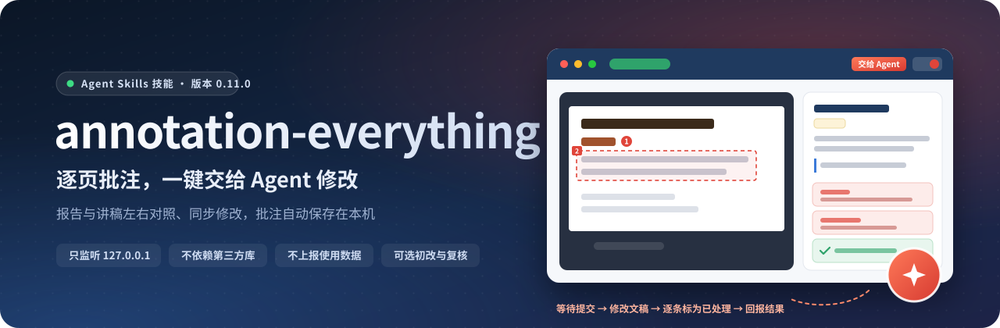
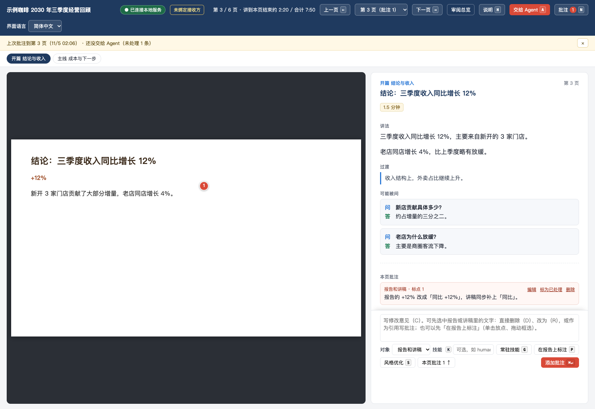
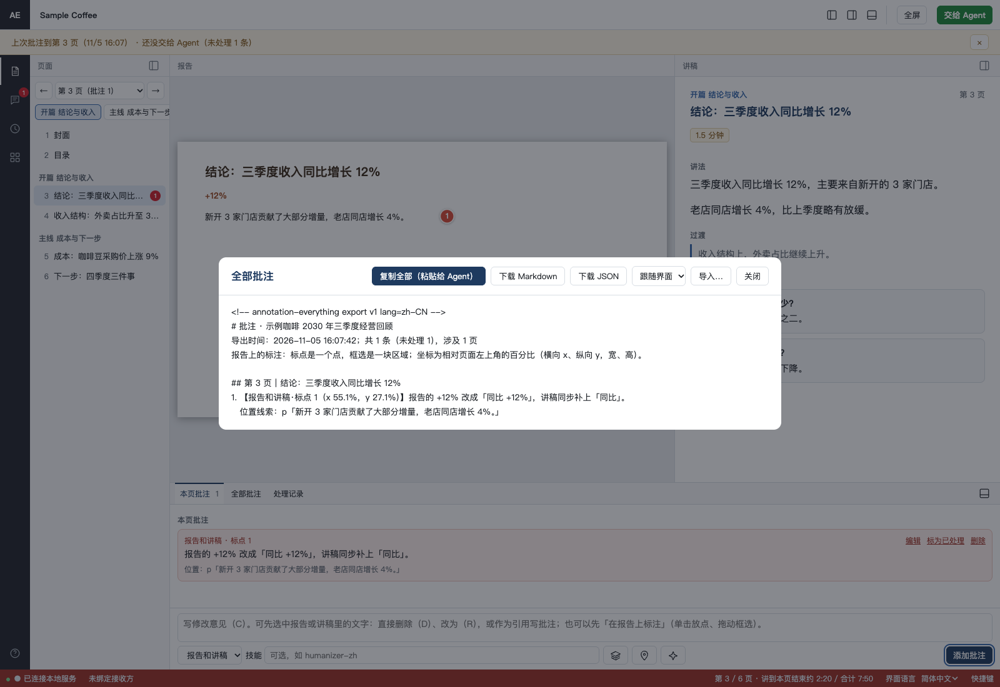
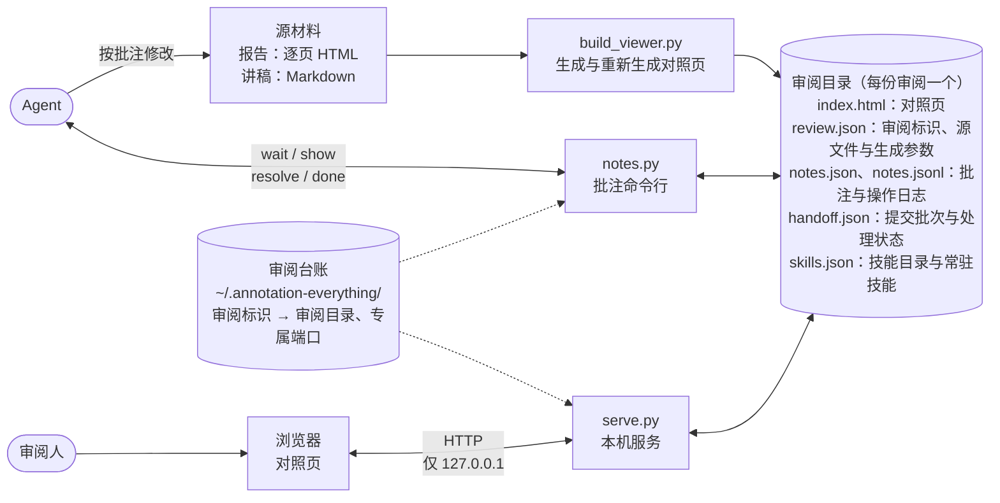
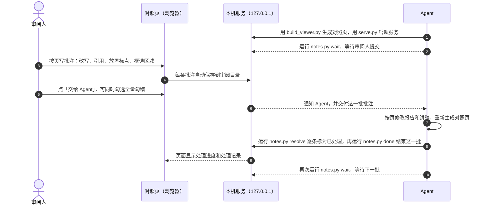
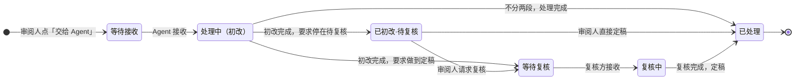
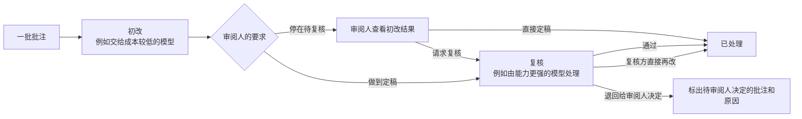

<p align="center">
  <b>简体中文</b> · <a href="README.en.md">English</a>
</p>

<p align="center">
  
</p>

<p align="center">
  annotation-everything 是一个在本机运行的审阅批注工具，以 Agent Skills 技能的形式提供。任何采纳 Agent Skills 开放标准的 Agent 都能使用它；默认安装到 Claude Code 的技能目录，也能用 <code>--target</code> / <code>--link</code> 装进其他技能目录。<br>它把逐页 HTML 报告和配套讲稿并排放在同一个页面里。审阅人在浏览器中按页写批注，写完一键提交，由 Agent 按批注修改报告和讲稿。
</p>

<p align="center">
  
  
  
  
  
</p>

<p align="center">
  <a href="#为什么需要它">为什么需要它</a> ·
  <a href="#功能">功能</a> ·
  <a href="#工作原理">工作原理</a> ·
  <a href="#快速开始">快速开始</a> ·
  <a href="#安全与隐私">安全与隐私</a> ·
  <a href="#项目结构">项目结构</a> ·
  <a href="#开发">开发</a>
</p>

<br>

<p align="center">
  
  <br>
  <sub>对照页：左侧是带标点的报告，右侧是讲稿和本页批注；也支持拖动框选区域。图中数据均为虚构样例。</sub>
</p>

## 为什么需要它

审阅一份几十页的汇报材料，常见做法是截图、标红、发消息，再把每条意见转述给改稿的人或 Agent。这样做有几个问题：意见分散在不同的地方，页码容易对不上；报告改了，讲稿常常忘了改；改到最后，也说不清哪些意见已经处理。

annotation-everything 把这套流程放进一个在本机运行的页面里：

- **意见留在原处**：每条批注都关联到具体的页、引用的原文或报告上的位置。Agent 收到的是带页码和位置的原始批注，不是转述。
- **报告与讲稿一起改**：报告和讲稿按页对应。在一侧选中句子写修改意见时，如果另一侧同一页有相同或相近的句子，页面会提示两侧一起改。Agent 按页修改后重新生成对照页。
- **处理过程有记录**：每次「交给 Agent」记为一批。每条批注都有处理状态和处理说明，可以随时回看。
- **材料不离开本机**：服务只监听 `127.0.0.1`，不访问网络，也不上报使用数据。批注保存在审阅人指定的审阅目录里。

## 功能

<table>
  <tr>
    <td width="50%" valign="top">
      <h4>✍️ 针对原文写批注</h4>
      选中报告或讲稿中的文字后，可以标记删除、给出改写，或者引用这段文字写意见。另一侧同一页有对应句子时，页面会提示一起修改。
    </td>
    <td width="50%" valign="top">
      <h4>📍 在报告上标注位置</h4>
      单击放置标点，按住拖动框选区域；标点和框都可以拖动，框可以调整大小。导出批注时会附上标注在页面上的位置（相对页面左上角的百分比坐标）。
    </td>
  </tr>
  <tr>
    <td valign="top">
      <h4>🤖 一键交给 Agent</h4>
      Agent 事先运行 <code>notes.py wait</code> 等待提交。审阅人点「交给 Agent」后，Agent 收到这一批批注，按页修改报告和讲稿，重新生成对照页，并逐条把批注标为已处理；页面实时显示处理进度。
    </td>
    <td valign="top">
      <h4>🔍 全量勾稽（检查全文前后一致性）</h4>
      提交时可以勾选这一项。Agent 除了处理批注，还会检查整份报告和讲稿中的数字、统计口径和前后表述是否一致，修正有依据的问题，并列出需要审阅人确认的事项。
    </td>
  </tr>
  <tr>
    <td valign="top">
      <h4>🧭 先改后审（可选）</h4>
      把一批批注分两段处理：先由一个模型完成初改，再由能力更强的模型复核；也可以在初改完成后停下，由审阅人决定复核还是直接定稿。每条批注都会保留每个阶段的处理过程。
    </td>
    <td valign="top">
      <h4>🧩 技能与常驻技能</h4>
      自动发现本机常见技能目录里的技能（<code>~/.claude</code>、<code>~/.codex</code>、<code>~/.agents</code>、<code>~/.zcode</code> 的技能目录与插件缓存），可以按名称和说明搜索，并根据审阅内容推荐。设为常驻技能后，Agent 处理设定范围内的每条批注时都会先调用这些技能。
    </td>
  </tr>
  <tr>
    <td valign="top">
      <h4>🗂️ 处理记录</h4>
      按批次查看每次提交处理了几条批注、各阶段由谁处理、处理说明是什么。重新打开页面时，会提示上次批注到了第几页、Agent 是否已经处理完。
    </td>
    <td valign="top">
      <h4>🔤 PPTX 字体核查</h4>
      PPTX 转成图片前，列出文件中声明的字体和本机缺少的字体；转出 PDF 后，再对照 PDF 中的字体嵌入情况。这样可以发现缺少字体时被自动替换成其他字体的问题。
    </td>
  </tr>
</table>

对照页可以选择简体中文或英文。生成时传入 `--locale auto`、`zh-CN` 或 `en`，页面上也可以切换，选择只保存在本机浏览器。批注原文保持原样，对象的存储值 `报告`、`讲稿`、`报告和讲稿` 不随语言改变。未配置语言时，新审阅保持中文，已有审阅沿用已保存的选择；`AE_LOCALE` 可覆盖已保存配置，显式参数优先。批注的新增、编辑、删除、重开、引用、快捷删除与改写、放点与框选、重新标注、风格优化、页码、讲稿栏、问答标签、编辑帮助、工具提示和无障碍名称都已支持两种语言；删除确认等对话框同样跟随当前语言。技能输入栏、候选与推荐、空结果、常驻技能的范围标签与增删提示，以及 `notes.py skills` 的输出也按当前语言显示；搜索仍按技能目录里的原始名称和原始说明匹配，常驻技能范围的存储值 `all` / `报告` / `讲稿` / `style` 不变。导出的 Markdown 可以选中文或英文（默认跟随界面），页面和命令行都能跨语言导入。「交给 Agent」弹窗、提交状态徽标、处理记录、回到上次提示和服务未连接时的提示也支持两种语言。提交选项（做到定稿还是停在待复核、是否允许派发子代理、是否全量勾稽）与界面语言无关。

<details>
<summary><b>导出与导入批注</b></summary>
<br>
<p align="center"></p>
没有 Agent 在等待时，可以在「全部批注」面板里复制全部批注，粘贴给任意 Agent；也可以下载为 Markdown 或 JSON 文件，之后再导入。

Markdown 的第一行是格式标记（`<!-- annotation-everything export v1 lang=… -->`），声明格式版本和内容语言，解析按它选中文或英文文法，与导入界面的语言无关——中文导出在英文页面、英文导出在中文页面都能导入，落库的协议值一致。导出的语言可以在面板里选，默认跟随界面；命令行用 `notes.py export --lang en`。用户正文、引用、处理说明和技能名称保持原文，只有系统包装文字翻译。没有标记的旧中文导出照读；认不出的文字会明确提示。旧版工具读不懂英文导出，会提示升级而不是猜。命令行同样能导出：`notes.py export 审阅目录 [--lang zh-CN|en] [--format json]`。
</details>

### 语言与 Agent 操作指引

只需安装一个技能副本。中文请求（如「按批注改」）和英文请求（如 “review this report” 或 “apply my annotations”）都由同一个 `annotation-everything` 入口处理，再按请求语言加载[中文流程](skill/annotation-everything/references/workflow.zh-CN.md)或[英文流程](skill/annotation-everything/references/workflow.en.md)。两种流程先读取同一份[安全与协议约束](skill/annotation-everything/references/protocol.md)，涵盖停在待复核、子代理权限、全量勾稽的证据和不确定性要求；无需按语言重复安装。

目前支持简体中文与英文。英文地区标签共用英文资源；`zh` / `zh-Hans` 映射到简体中文，不承诺繁体或其他语言。浏览器保存的选择优先于审阅默认值，`auto` 按浏览器语言偏好顺序匹配、不支持时回退英文。省略设置的新审阅和旧命令保持中文。界面、材料和批注语言相互独立，切换语言保留草稿与待补传改动。

服务模式可以实际提交，由已启动的等待机制或钩子接收；是否自动唤醒 Agent 取决于宿主支持。直接打开 `index.html` 时，只提供浏览器批注、复制和导出，需导入后交给 Agent。JSON 保留完整批注结构与审阅身份；Markdown 不保留 id、页面键、时间戳或处理批次，并有旧文法的文本限制，详见[格式说明](skill/annotation-everything/references/formats.md)。[交付验收记录](docs/locale-delivery.zh-CN.md)列出三种语言组合的完整流程、兼容矩阵、验证环境与限制。

## 工作原理

### 整体架构

所有组件都在本机运行。浏览器只和本机服务通信；Agent 通过命令行读写同一个审阅目录；审阅台账只记录每份审阅的标识、目录和端口。



### 一次审阅的完整流程



### 每一批的状态

每次点「交给 Agent」都会生成一个批次。不分两段处理时，批次从「处理中」直接变为「已处理」；选择先改后审时，初改完成后还要经过复核，或者由审阅人直接定稿。



### 先改后审：初改与复核

复核方逐条给出结论：通过、自己直接再改，或者退回给审阅人决定。复核方不会把批注退回给初改方。



## 安装与维护

管理命令是仓库根目录的 `ae.py`（只用 Python 标准库），四个子命令：`install` 安装、`doctor` 体检、`repair` 修复、`uninstall` 卸载。本工具是 Agent Skills 技能：任何采纳 Agent Skills 开放标准的 Agent 都能加载 `SKILL.md` 并按它工作。默认装进 Claude Code 的技能目录，其余 Agent 的技能目录用 `--target` 和 `--link` 覆盖（见下）。

### 给人看

前提：Python 3.9 及以上，macOS 或 Linux。

```bash
python3 ae.py install                            # 安装：把技能复制为技能副本到 ~/.claude/skills/
python3 ae.py install --target <目录>            # 或装到其他技能目录的根（副本装在 <目录>/annotation-everything）
python3 ae.py install --link codex,agents,zcode  # 可选：同时为这些 Agent 建指向副本的软链接
python3 ae.py install --link cursor=~/.cursor/skills  # --link 也接受 名称=路径，为任意技能目录建链接
python3 ae.py doctor                             # 体检：安装状态、运行状态、可选工具、开发环境
python3 ae.py repair                             # 修复：先列计划，安全项自动修
python3 ae.py uninstall                          # 卸载：删除技能副本和链接，默认保留审阅台账
python3 ae.py doctor --target <目录>             # doctor/repair/uninstall 同样接受 --target，定位自定义位置的副本
python3 ae.py doctor --locale en                 # 可选：界面语言 auto、zh-CN 或 en（写在子命令前后都认）
```

- 体检逐项给出「通过 / 警告 / 失败」；失败项附修复或排障命令。退出码 0 表示全部通过或只有警告，1 表示有失败项，2 表示命令自身出错（`doctor --json` 输出 `error`）。开发环境类别仅在当前工作目录位于来源仓库内时出现。
- **界面语言**：`ae.py`、`serve.py`（`serve` / `status` / `list` / `forget` / `check`）、`notes.py`、`check_pptx_fonts.py` 都支持 `--locale auto|zh-CN|en`（写在子命令前后都认）和环境变量 `AE_LOCALE`；生成器的帮助、结果与资源诊断也按显式 `--locale`、`AE_LOCALE`、已保存审阅配置的顺序选语言。优先级是显式参数、`AE_LOCALE`，两者都没有则中文；只有 `auto` 才读 `LC_ALL` / `LC_MESSAGES` / `LANG`。`serve.py serve` 和 `serve.py status` 在目录解析出来后还会回落到那份审阅里保存的 `locale`；`list` / `forget` / `check` 不对应单份审阅，只认前两级。语言选择非法时命令以退出码 2 停下并说明原因，不改动任何状态。帮助、参数说明、缺参、非法值和命令失败都用同一种语言；来源路径、命令、字体名、技能名与系统原始错误保持原文。
- **机器判定与人读文案分开**：`doctor --json` 的 `category`、`level`、`code` 和 `summary` 是旧消费者在读的判定字段，恒为中文、不随语言改值；新增的语言无关判定信息是每项的 `status`（`pass` / `warn` / `fail`）和 `category_id`（`install` / `tools` / `dev` / `runtime`），以及顶层的 `schema`（结构版本）和 `locale`（`message` 用的是哪种语言）。新消费者比较 `status` / `category_id` 即可，不必比较本地化标签；`message`、`fix_command` 里的人读文案按语言变。`serve.py` 的拒绝与错误同理：HTTP 状态和原因代码（`bad-host`、`cross-site`、`bad-origin`、`no-origin`、`bad-content-type`、`chunked`、`bad-length`、`too-large`、`bad-json`、`not-found`、`preflight`、`no-index`、`no-note`、`server-error`、`review-mismatch`、`no-api`）不随语言变，说明按服务启动时定的语言输出；未知错误只说明类型与恢复动作，不回显请求内容。
- `repair` 里删除台账失效记录（`--forget-stale`）、结束残留服务（`--stop-orphans`）是破坏性操作，要显式加参数；`--dry-run` 只看计划不动手。计划与执行报告都写清楚「本次未执行」，翻译后的提示不弱化后果。
- `uninstall` 任何情况下都不动审阅目录；`--purge` 才一并删除审阅台账；有 `serve.py` 在运行时会拒绝，`--stop-servers` 先停止再卸。
- **装到别的技能目录**：`install` 缺省把技能副本装到 `~/.claude/skills/`（`CLAUDE_SKILLS_DIR` 仍可覆盖），`--target <目录>` 改为装到 `<目录>/annotation-everything`；`doctor`、`repair`、`uninstall` 接受同一个 `--target` 对该副本体检、修复、卸载，失败项的修复命令会带上同一 `--target`。`--link` 除内置名称 `codex`、`agents`、`zcode` 外还接受 `名称=路径`（如 `cursor=~/.cursor/skills`），为任意技能目录建指向副本的软链接并记入安装记录；自定义链接同样出现在体检里（悬空时报失败项与修复命令），`repair` 能重建，`uninstall` 会删除。安装记录只存在技能副本里，副本删除后自定义链接无法再被自动发现（内置目录的链接仍有扫描兜底）。
- 停止服务前会核实正在执行的是本仓库或当前技能副本的脚本，并在发信号前复核进程身份；无法核实时拒绝停止。`--purge` 仅删除已知台账文件；台账损坏、目录内有其他文件或未登记的审阅目录时拒绝清除。

装好后对 Agent 说「帮我审阅这份报告和讲稿」或「我批注完了，按批注改」，它就会按这套流程工作。技能怎么被唤醒、批注指定的技能怎么调用，各 Agent 的机制不同，对照见 [SKILL.md](skill/annotation-everything/SKILL.md) 的「各 Agent 的对应机制」一节。

### 给 Agent 看

把下面这段发给你的 Agent，并把 `<仓库路径>` 换成本仓库的绝对路径：

> 在 `<仓库路径>` 安装并体检 annotation-everything 技能，按编号步骤执行，每步先确认成功标志再往下：
>
> 1. 运行 `python3 <仓库路径>/ae.py doctor --json`。退出码 2 时先查看 JSON 的 `error` 并排障；若提示安装记录损坏，可按第 2 步重新安装。正常输出中，若 `results` 里没有 `category` 为「安装状态」且 `level` 为「失败」的项，说明已装好，跳到第 4 步。
> 2. 按你是哪种 Agent 决定链接参数：Claude Code 不需要 `--link`；Codex 用 `--link codex`；`~/.agents` 下的 Agent 用 `--link agents`；zcode 用 `--link zcode`；其他 Agent 用 `--link 名称=技能目录`（如 `--link cursor=~/.cursor/skills`）。不把主副本装进 Claude 目录时加 `--target <目录>`（后续 `doctor` / `repair` / `uninstall` 带同一个值）。运行 `python3 <仓库路径>/ae.py install`（需要时加上对应参数）。成功标志：退出码 0。
> 3. 再次运行 `python3 <仓库路径>/ae.py doctor --json`，以 JSON 判定成败：优先看语言无关的判定字段——`results` 里没有 `status` 为 `fail` 且 `category_id` 为 `install` 的项即安装成功（`category` 为「安装状态」且 `level` 为「失败」的旧写法仍然成立，这两个字段恒为中文）。「运行状态」类的失败（如残留服务、专属端口被占用）不影响安装，记下来在第 5 步报告；`summary.warn` 里的警告（如缺少可选工具 `fc-list`/`pdffonts`）不阻塞使用。「安装状态」类仍有失败时，按该项的 `fix_command` 修复后重跑本步；`fix_command` 含第 4 步列出的破坏性参数时，先征得用户同意再执行。
> 4. 需要修复时运行 `python3 <仓库路径>/ae.py repair`（`--dry-run` 先看计划）。**`--purge`、`--forget-stale`、`--stop-orphans`、`--stop-servers` 都是破坏性操作，必须先征得用户同意再加。**
> 5. 完成后向用户报告：安装是否成功、各项体检结果，以及尚未解决的警告。

界面文案默认中文。需要英文输出时，在上面任何一条命令后加 `--locale en`（也可设环境变量 `AE_LOCALE=en`）；机器判定用 `status` / `category_id`，与语言无关。

## 快速开始

**1. 安装技能**

```bash
python3 ae.py install
```

技能会被复制到 `~/.claude/skills/annotation-everything`（这份复制称为「技能副本」）；要装到其他技能目录的根，用 `python3 ae.py install --target <目录>`（副本装在 `<目录>/annotation-everything`）。安装、体检、修复、卸载的完整说明见上面「安装与维护」。

**2. 用合成样例试用**

```bash
S=skill/annotation-everything/scripts
export AE_HOME=$(mktemp -d)   # 试用时把审阅台账放到临时目录，不影响本机真实的台账
python3 $S/build_viewer.py --report fixtures/sample/report.html --script fixtures/sample/script.md --out /tmp/ae-demo
python3 $S/serve.py /tmp/ae-demo
```

浏览器会自动打开对照页。写几条批注，点「交给 Agent」，然后在另一个终端运行：

```bash
python3 $S/notes.py wait /tmp/ae-demo
```

命令会输出刚才提交的批注，这就是 Agent 收到的内容。

想试英文材料，把 `--report` 换成 `fixtures/sample/report.en.html`，`--script` 换成 `fixtures/sample/script.en.md`，加 `--locale en` 即可体验英文界面；只换材料时界面语言不变，也可用英文界面审阅原来的中文材料。

**3. 准备自己的材料**

- **报告**：一份 HTML 文件，每一页是一个 `<section class="page" data-page="N" data-key="唯一键">` 元素。
- **讲稿**：一份 Markdown 文件，中文用 `### 第 N 页｜标题` 分页，每页写明时长、讲法、过渡和可能被问到的问题；英文讲稿写 `### Page N｜Title` 加 `**Duration**` / `**Talking points**` / `**Transition**` / `**Likely questions**`。两种写法可以在同一份讲稿里混用，认哪种写法与界面语言无关：中文界面能审阅英文讲稿，英文界面能审阅中文讲稿，标题和正文按原文保留、不翻译。页头认不出来、页码重复或字段重复时，生成器按当前语言给出行号与期望写法，不把错输入当成空讲稿。

完整格式见 [references/formats.md](skill/annotation-everything/references/formats.md)。

<details>
<summary><b>常用命令一览</b></summary>

| 命令 | 作用 |
|---|---|
| `ae.py install` / `doctor` / `repair` / `uninstall` | 仓库根目录的管理命令：安装技能副本到 `~/.claude/skills/`（`--target <目录>` 装到其他技能目录的根；`--link codex,agents,zcode` 或 `名称=路径` 为其他 Agent 建指向副本的软链接）；体检安装状态、运行状态、可选工具、开发环境（`--json` 输出结构化结果，含语言无关的 `status` / `category_id` 判定字段）；修复体检发现的问题（先列计划，安全项自动修，`--forget-stale`/`--stop-orphans` 显式执行破坏性操作，`--dry-run` 只看计划）；卸载时删除技能副本和指向它的链接，默认保留审阅台账（`--purge` 一并删除，审阅目录任何情况下都不动；有 `serve.py` 在运行时拒绝，`--stop-servers` 先停止）。四个子命令都接受 `--target <目录>` 定位自定义位置的副本；都可加 `--locale auto\|zh-CN\|en` 或设 `AE_LOCALE` 选界面语言 |
| `verify.py plan` / `run` / `report` | 仓库根目录的统一验证入口：`plan` 解释将执行哪些组与命令，不启动测试（`plan --phase development` 还给出当前改动选测建议与回退原因）；`run` 执行并把结构化记录和原始日志写进 `.verify/`（已忽略），默认影子模式记录选测建议与完整检查的对照，并把当前仍有效的通过证据跨阶段引用给后续阶段（`--no-reuse` 强制全部重跑）；`report` 只读记录并展示证据链。组有 `unit`（完整单元）、`unit-related`（显式指定的相关单元，自动附带 `tests/test_i18n_catalog_contract.py` 的全局词典一致性契约）、`browser`（完整浏览器）、`serve-check`（服务安全自检）、`all`（按 `unit` → `serve-check` → `browser` 顺序执行）。字段契约见 [docs/verify/record-contract.md](docs/verify/record-contract.md)，选测策略见 [docs/verify/selection-strategy.md](docs/verify/selection-strategy.md) |
| `build_viewer.py --report … --script … --out 审阅目录` | 生成对照页；`--rebuild 审阅目录` 按上次记录的参数重新生成；`--locale auto`、`zh-CN` 或 `en` 设定界面语言，省略时新审阅保持中文，重建沿用已保存的选择 |
| `serve.py 审阅目录` | 启动本机服务；每份审阅都有固定的专属端口。`--locale auto\|zh-CN\|en` 或 `AE_LOCALE` 选诊断说明的语言 |
| `serve.py list` / `status` / `forget` | 列出本机所有审阅、查看某份审阅的状态、删除不再使用的台账记录 |
| `serve.py check` | 运行服务安全自检 |
| `notes.py wait` / `claim` | 等待审阅人提交，或直接接收已有的提交。`wait --locale` 选择交接语言，保留定位、操作与技能要求；`claim` 输出的 JSON 保持原始值 |
| `notes.py show` / `resolve` / `reopen` | 列出批注、标为已处理、重新打开。`show --locale` 选择阅读语言，优先于 `AE_LOCALE` 和审阅设置；`show --json` 仍导出原始值 |
| `notes.py export` / `import` | 导出可再导入的批注摘要（Markdown 带版本与语言标记，或 JSON 结构化备份）／导入页面导出的 JSON 或 Markdown。`export --lang` 与 `show --locale` 同一套优先级，`--format json`、`--all`、`--page N`、`--out 文件` |
| `notes.py done` / `review` / `diff` | 结束当前阶段、给出复核结论、按页查看初改改动了哪些地方；均可用 `--locale` 选择输出语言 |
| `notes.py batches` | 查看处理记录 |
| `notes.py skills` | 查看或设置技能目录和常驻技能。`--locale` 选择输出语言，优先于 `AE_LOCALE` 和审阅设置；范围可写 `全部` / `报告` / `讲稿` / `风格优化` 或 `all` / `report` / `script` / `style` |
| `check_pptx_fonts.py 原始.pptx [--pdf 转换后.pdf]` | PPTX 转换前后的字体核查；`--locale auto\|zh-CN\|en` 或 `AE_LOCALE` 选界面语言 |

</details>

## 安全与隐私

| 约束 | 实现方式 |
|---|---|
| 只在本机访问 | 服务只监听 `127.0.0.1`，校验请求的 Host 头，不返回跨域访问（CORS）响应头 |
| 防止跨站伪造写入 | 写入请求的来源（Origin）必须与页面同源，并且内容类型必须是 JSON |
| 只开放必要的内容 | 只提供 `index.html` 和 `/api/*` 接口，审阅目录里的其他文件无法通过服务访问 |
| 不依赖第三方 Python 库 | 运行时只用 Python 标准库；字体核查会调用系统工具 `fc-list` 和 `pdffonts`，缺少时会给出安装提示 |
| 不访问网络 | 不上报使用数据；报告中引用的外部资源不加载，本地图片和字体直接嵌入页面 |
| 数据留在本地 | 批注和对照页都保存在审阅人指定的审阅目录；本机的审阅台账 `~/.annotation-everything/` 只记录审阅标识、目录路径和端口 |

每次修改服务后运行 `serve.py check`，它会逐项检查以上约束。

## 项目结构

```text
skill/annotation-everything/       技能本体，安装时整体复制
├── SKILL.md                       中英文发现入口，按请求语言加载流程
├── references/
│   ├── protocol.md               共用安全、停止条件与协议约束
│   ├── workflow.zh-CN.md          中文操作流程
│   ├── workflow.en.md             英文操作流程
│   ├── agent-mechanisms.zh-CN.md  各 Agent 的等待、技能调用与分派机制
│   ├── agent-mechanisms.en.md     英文 Agent 机制对照
│   ├── formats.md                 中文输入与输出格式
│   └── formats.en.md              英文输入与输出格式
├── locales/                       中英消息（zh-CN.json、en.json）和语言选择契约
├── scripts/
│   ├── build_viewer.py            生成对照页 index.html 和 review.json
│   ├── i18n.py                    读取共享词典，并按所选语言插值
│   ├── viewer_template.html       对照页模板（服务模式和本地文件模式）
│   ├── serve.py                   本机服务：serve / status / list / forget / check
│   ├── notes.py                   批注命令行：wait / show / resolve / done / review 等
│   ├── notes_store.py             批注存储：原子写入、文件锁、操作日志
│   ├── export_format.py           批注交换格式：带标记的 Markdown 文法与 JSON 备份
│   ├── ledger.py                  审阅台账：审阅标识、审阅目录和专属端口
│   ├── match.py                   在报告与讲稿之间查找对应句子
│   ├── skill_sources.py           发现本机的技能目录
│   └── check_pptx_fonts.py        PPTX 与 PDF 字体核查
└── evals/                         技能评测用例（供 skill-creator 使用）
ae.py                             统一管理命令：install 安装技能副本，doctor 体检，repair 修复，uninstall 卸载
verify.py                         统一验证入口：plan 解释范围，run 执行并记录，report 只读记录
verify_selection.py               阶段选测与影子对照策略：版本化映射、保守回退与遗漏对照
verify_evidence.py                证据复用策略：同输入同环境且当前有效的通过记录跨阶段引用
host_isolation.py                 同机资源隔离协议：验证参与方按共享资源互斥的锁与声明
fixtures/sample/                   合成样例（虚构数据）
tests/                             单元测试和浏览器端到端测试
tests/e2e_waits.py                  浏览器条件等待：有界轮询、事件等待与场景级超时诊断
tools/
├── setup-dev.sh                   启用仓库自带的 git 钩子
└── git-hooks/                     拒绝在 main 上提交、推送到 main、删除 main
.github/                           CI、issue 模板和 PR 模板
docs/                              架构决策记录（ADR）、Agent 协作约定、README 配图
docs/verify/                       验证记录字段契约、统一入口接入说明与浏览器场景注册
GLOSSARY.md                        术语表
```

## 开发

克隆后先运行一次 `tools/setup-dev.sh` 启用 git 钩子。

```bash
python3 verify.py plan                                            # 统一验证入口：解释将执行哪些组与命令
python3 verify.py plan --phase development                        # 选测建议：当前改动该跑什么、为什么、何时回退
python3 verify.py run                                             # 完整单元（缺省组），结束后打印摘要
python3 verify.py run --group all                                 # 完整验收：单元 + 服务安全自检 + 浏览器
python3 verify.py run --no-reuse                                  # 独立复测：绕过证据复用，全部实际执行
python3 verify.py report --latest                                 # 只读最近一次记录，不启动测试
python3 -m unittest discover tests                                   # 单元测试（只用标准库）
uv run --no-project --with playwright python tests/e2e_browser.py   # 浏览器端到端测试（使用本机的 Google Chrome）
python3 skill/annotation-everything/scripts/serve.py check          # 服务安全自检
python3 ae.py install                                               # 同步到 ~/.claude/skills/
uv run --no-project --with playwright python tests/e2e_browser.py --list            # 浏览器场景清单（ID、行为、fixture、隔离）
uv run --no-project --with playwright python tests/e2e_browser.py --only skill-i18n # 只跑选定的浏览器场景（逗号分隔、去重；--delivery-only 等旧参数保留为别名）
```

`verify.py` 是统一验证入口：`plan` 解释范围，`run` 执行并把结构化记录和原始日志写进 `.verify/`（已被忽略），`report` 只读记录。输入指纹包含有效输入文件的完整内容；文本与 JSON 报告保留原测试结果，并显示当前校验后的证据可用性。记录还含提交与基线、环境和逐用例耗时，字段契约见 [docs/verify/record-contract.md](docs/verify/record-contract.md)，接入说明见 [docs/verify/onboarding.md](docs/verify/onboarding.md)。它不裁剪实际执行的组；原来的直接命令继续有效，完整执行的成功 / 失败退出码语义一致。空集合与全跳过不算通过，新入口返回 1。同机多个工作区并行验证时，资源敏感的组（完整单元、完整浏览器、敏感模块直跑）按共享资源自动互斥排队：跨 worktree 与独立 checkout 生效，锁等待单独计时、超时不算通过，纯逻辑组不受影响；详见[同机资源隔离协议](docs/verify/isolation.md)。

阶段选测与影子对照默认开启：`run` 依据版本化的映射（`verify_selection.py`）记录「当前改动建议跑什么」，实际执行仍是请求的完整门禁；结束时把建议范围与实际结果并列对照，完整检查发现而建议范围没覆盖的失败保留为候选遗漏并归因。未知路径、坏基线、损坏规则、测试清单缺口和策略自身变化一律保守回退完整检查并解释原因。`issue` 阶段不自动启动测试，缺陷复现显式请求相关组。策略、回退情形与对照样本见 [docs/verify/selection-strategy.md](docs/verify/selection-strategy.md)。

有效验证证据跨阶段引用（`verify_evidence.py`，判定从紧）：同输入指纹、同环境、请求范围被已验证范围覆盖，且来源记录当前校验后仍可作为通过证据、未超 24 小时保鲜窗口、版本一致时，`run` 在 `issue` / `development` / `review` / `manual` 阶段直接引用已有结果并写明来源 run 与理由（差异被证明仅在文档允许列表内时不算输入变化；覆盖映射下停用该放宽）；依赖宿主机状态的组（完整单元、完整浏览器、敏感模块直跑）指纹相同也不复用，`pr` / `ci` 门禁阶段必须实际执行，点名到类 / 用例的补测不复用。被引用的组在记录与报告中显示为「引用已有验证」，不重复计入通过数量；来源被篡改或失效时报告降级为不可用。`--no-reuse` 强制全部重跑。

浏览器端到端测试按场景注册执行：无参数跑全部注册场景；`--list` 列出场景清单，`--only 场景1,场景2` 去重后只跑目标场景及其声明的准备步骤，未知、空或冲突的选择在启动浏览器前报错。场景注册表、旧参数别名与新增场景的接入规则见 [docs/verify/browser-scenarios.md](docs/verify/browser-scenarios.md)。

浏览器等待按待验证的行为观察 DOM、文件状态、网络事件或服务修订，并在超时时记录场景、条件和最后状态。必要的固定观察窗口、行为对照和性能证据见 [docs/verify/browser-waits.md](docs/verify/browser-waits.md)。

- 测试会把审阅台账放到临时目录（环境变量 `AE_HOME`）。手动试用或运行技能评测时，也建议先执行 `export AE_HOME=$(mktemp -d)`，避免临时审阅登记进本机真实的台账，或占用真实审阅的专属端口。
- 验收产物可用 `AE_DELIVERY_ARTIFACTS` 指向 `skill/annotation-everything-workspace/` 下的目录，保留合成源材料、命令输出、批次状态、离线导出和截图。具体命令与评测边界见[交付验收记录](docs/locale-delivery.zh-CN.md)。
- `main` 只通过 PR 的 squash 合并更新：从 issue 开分支，PR 正文写 `Closes #编号`，CI 通过后合并，issue 随合并自动关闭。完整流程见 [AGENTS.md](AGENTS.md)「分支、issue 与 PR」。
- 仓库中只放合成样例。真实材料、批注和审阅目录一律不放进仓库，也不放进技能目录。
- 术语以 [GLOSSARY.md](GLOSSARY.md) 为准；架构决策记录见 [docs/adr/](docs/adr/)；协作约定见 [AGENTS.md](AGENTS.md)。
