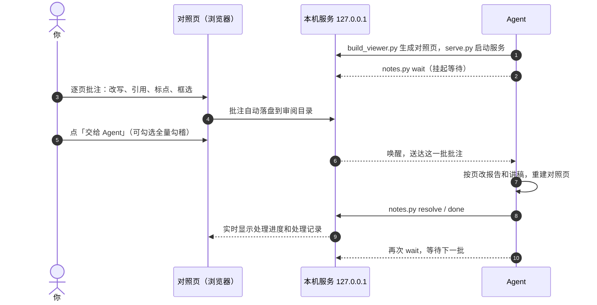

<p align="center">
  <b>简体中文</b> · <a href="README.en.md">English</a>
</p>

<p align="center">
  
</p>

<p align="center">
  <b>本机审阅批注工作台</b>：把逐页汇报材料和讲稿合成左右对照页，在浏览器里逐页批注，一键交给 Agent 按批注落实修改。
</p>

<p align="center">
  
  
  
  
  
</p>

<p align="center">
  <a href="#为什么需要它">为什么</a> ·
  <a href="#功能">功能</a> ·
  <a href="#工作流">工作流</a> ·
  <a href="#快速开始">快速开始</a> ·
  <a href="#安全与隐私">安全与隐私</a> ·
  <a href="#项目结构">项目结构</a> ·
  <a href="#开发">开发</a>
</p>

<br>

<p align="center">
  
  <br>
  <sub>对照页：左侧是报告，可以单击标点、拖动框选；右侧是讲稿和本页批注。图中数据均为虚构样例。</sub>
</p>

## 为什么需要它

审阅一份几十页的汇报稿，常见做法是截图、标红、发消息，再逐条转述给改稿的人或 Agent。意见容易散落、页码对不上，报告改了讲稿却忘了改，也说不清哪些已经处理。

annotation-everything 把这条链路收拢在一个本机页面里：

- **意见落在原处**：批注绑定到页、选中的原文或报告上的位置，Agent 拿到的是结构化意见，不是一段转述。
- **改稿两侧同步**：报告和讲稿按页对应，改了一侧会提示另一侧同一句；Agent 按页落实后重建对照页。
- **处理有记录**：每次「交给 Agent」记为一批，每条批注都有处理状态和处理摘要，可以随时回看。
- **材料不出本机**：服务只监听 `127.0.0.1`，不联网、无遥测，批注写在你指定的审阅目录里。

## 功能

<table>
  <tr>
    <td width="50%" valign="top">
      <h4>✍️ 原文级批注</h4>
      选中报告或讲稿里的文字，直接删除、改写或引用后写意见；另一侧同一页有对应句时提示「同时改」。
    </td>
    <td width="50%" valign="top">
      <h4>📍 在报告上标注</h4>
      单击放标点，拖动框选区域；标注可以拖动、调大小，导出时带上相对页面的坐标。
    </td>
  </tr>
  <tr>
    <td valign="top">
      <h4>🤖 交给 Agent</h4>
      一键提交整批批注。Agent 用 <code>notes.py wait</code> 挂起等待，被唤醒后按页改稿、重建页面、逐条标记已处理，页面实时显示进度。
    </td>
    <td valign="top">
      <h4>🔍 全量勾稽</h4>
      提交时可以勾选全量勾稽，让 Agent 通查整份报告和讲稿的数字、口径与前后表述，修正有依据的问题，并列出待确认事项。
    </td>
  </tr>
  <tr>
    <td valign="top">
      <h4>🧭 先改后审</h4>
      可选两段流程：先由一个模型初改，再由更强的模型复核；也可以停在待复核，由你拍板。每条批注都留下处理痕迹。
    </td>
    <td valign="top">
      <h4>🧩 技能与常驻技能</h4>
      自动发现本机的 Claude Code / Codex 技能，按名称和说明搜索，按审阅上下文推荐；常驻技能按范围约束每一条批注。
    </td>
  </tr>
  <tr>
    <td valign="top">
      <h4>🗂️ 处理记录</h4>
      按批查看每次提交解决了几条、处理摘要是什么；重新打开页面时提示上次批注到了哪一页。
    </td>
    <td valign="top">
      <h4>🔤 PPTX 字体核查</h4>
      PPTX 转图前列出声明字体和本机缺失的字体，转出 PDF 后对照嵌入和子集信息，避免字体悄悄回退。
    </td>
  </tr>
</table>

<details>
<summary><b>导出与导入批注</b></summary>
<br>
<p align="center"></p>
没有 Agent 在等时，也可以复制全部批注粘贴给任意 Agent，或者下载 Markdown / JSON 之后再导入。
</details>

## 工作流



## 快速开始

**1. 安装 skill**

```bash
tools/install.sh
```

skill 会被拷贝到 `~/.claude/skills/annotation-everything`。之后在 Claude Code 里说一句「帮我审阅这份报告和讲稿」或「我批注完了，按批注改」，就会进入这套流程。

**2. 用合成样例试一试**

```bash
S=skill/annotation-everything/scripts
export AE_HOME=$(mktemp -d)   # 试用时把审阅台账放到临时目录
python3 $S/build_viewer.py --report fixtures/sample/report.html --script fixtures/sample/script.md --out /tmp/ae-demo
python3 $S/serve.py /tmp/ae-demo
```

浏览器会打开对照页。写几条批注、点「交给 Agent」，再在另一个终端运行：

```bash
python3 $S/notes.py wait /tmp/ae-demo
```

**3. 准备自己的材料**

- **报告**：一份 HTML，每页是 `<section class="page" data-page="N" data-key="唯一键">`。
- **讲稿**：Markdown，按 `### 第 N 页｜标题` 分页，每页写时长、讲法、过渡、可能被问。

完整格式见 [references/formats.md](skill/annotation-everything/references/formats.md)。

<details>
<summary><b>常用命令一览</b></summary>

| 命令 | 作用 |
|---|---|
| `build_viewer.py --report … --script … --out 审阅目录` | 生成对照页；`--rebuild 审阅目录` 按原参数重建 |
| `serve.py 审阅目录` | 启动本机服务，每份审阅有固定的专属端口 |
| `serve.py list` / `status` / `forget` | 查看本机所有审阅、单份状态，移除不再用的登记 |
| `serve.py check` | 服务安全自检 |
| `notes.py wait` / `claim` | 等待或直接接收用户的提交 |
| `notes.py show` / `resolve` / `reopen` | 查看批注、标记已处理、重新打开 |
| `notes.py done` / `review` / `diff` | 收尾当前阶段、给出复核结论、按页查看初改的改动 |
| `notes.py batches` | 查看处理记录 |
| `notes.py skills` | 查看或设置技能目录与常驻技能 |
| `check_pptx_fonts.py 原始.pptx [--pdf 转换后.pdf]` | PPTX 转图前后的字体核查 |

</details>

## 安全与隐私

| 约束 | 做法 |
|---|---|
| 只在本机 | 服务只绑 `127.0.0.1`，校验 Host 头，不发跨域头 |
| 写操作防伪造 | 写请求必须同源 Origin，并且是 JSON Content-Type |
| 最小暴露面 | 只提供 `index.html` 和 `/api/*`，不暴露审阅目录里的其他文件 |
| 零第三方依赖 | 运行时只用 Python 标准库；字体核查会用到系统自带的 `fc-list` / `pdffonts`，缺失时会提示 |
| 不联网 | 无遥测；报告里的外链资源不加载，本地图片和字体内联进页面 |
| 数据归你 | 批注和对照页都在你指定的审阅目录；本机台账 `~/.annotation-everything/` 只记标识、路径和端口 |

每次改动服务后运行 `serve.py check`，这些约束都会被逐项自检。

## 项目结构

```text
skill/annotation-everything/       skill 本体，安装时整体拷贝
├── SKILL.md                       Agent 读的操作说明
├── references/formats.md          输入输出格式
├── scripts/
│   ├── build_viewer.py            生成对照页 index.html 和 review.json
│   ├── viewer_template.html       对照页模板（服务模式 / 本地文件模式）
│   ├── serve.py                   本机服务：serve / status / list / forget / check
│   ├── notes.py                   批注命令行：wait / show / resolve / done / review …
│   ├── notes_store.py             批注存储：原子写、文件锁、操作日志
│   ├── ledger.py                  本机审阅台账：审阅标识、目录与专属端口
│   ├── match.py                   报告与讲稿的对应句查找
│   ├── skill_sources.py           本机技能目录发现
│   └── check_pptx_fonts.py        PPTX / PDF 字体核查
└── evals/                         skill-creator 测试用例
fixtures/sample/                   合成样例（虚构数据）
tests/                             单元测试与浏览器端到端测试
tools/install.sh                   安装到 ~/.claude/skills/
docs/                              ADR、Agent 协作约定、README 配图
GLOSSARY.md                        术语表
```

## 开发

```bash
python3 -m unittest discover tests                                   # 单元测试（标准库）
uv run --no-project --with playwright python tests/e2e_browser.py   # 浏览器端到端（本机 Google Chrome）
python3 skill/annotation-everything/scripts/serve.py check          # 服务安全自检
tools/install.sh                                                     # 同步到 ~/.claude/skills/
```

- 测试会把审阅台账指到临时目录（`AE_HOME`）。手动试用或跑 eval 时也建议先 `export AE_HOME=$(mktemp -d)`，免得临时审阅登记进真实台账、占掉专属端口。
- 仓库里只放合成样例。真实材料、批注和审阅目录一律不进仓库，也不进 skill 目录。
- 术语以 [GLOSSARY.md](GLOSSARY.md) 为准，架构决策见 [docs/adr/](docs/adr/)，协作约定见 [AGENTS.md](AGENTS.md)。
