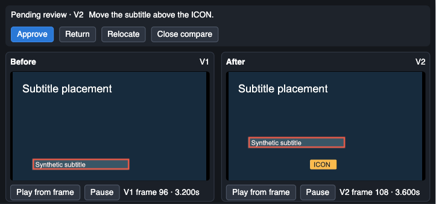

# Review a source change on a video cut

[中文](video-acceptance.zh-CN.md)

Use two separate local projects for this walkthrough. Each review has one engine, one composition, and one bound receiving session. The synthetic source generator and dependency versions are in the [fixture guide](../fixtures/video/README.md).

## Start a review

Set `S` to the installed skill's `scripts` directory, `R` to a new local review directory and `P` to the project root. Use the same isolated `AE_HOME` for the reviewer and receiver of each demo.

| Starting material | Action | What to check |
| --- | --- | --- |
| Source project | Run `python3 "$S/video_engines.py" inspect "$P"`, then `python3 "$S/build_viewer.py" --report "$P" --video-composition ENTRY --out "$R" --locale en`. | Choose the intended composition if several are listed. A missing cut is rendered. Inspect the candidate evidence before explicitly confirming reuse with `--reuse-movie PATH`. |
| MP4 | Run `python3 "$S/build_viewer.py" --report cut.mp4 --out "$R" --locale en`. | Add annotations before linking the project. Use **Link source project**, enter the engine, root and entry, then confirm any differences. The original annotations still open V1. |

Start the local page with `python3 "$S/serve.py" "$R"`. In the receiving session, bind the review using its supported host adapter. For the wait adapter, use `python3 "$S/wakeup.py" bind "$R" --adapter wait --harness "$AE_HARNESS" --session "$AE_SESSION_ID"`. Set those two variables to the actual receiving session's harness and stable identity before binding. The same identity must claim the work and submit the receipts.

## Revise and compare

1. Add five annotations. At 30 fps, drag a region around the subtitle on frame 96. Mark frames 120 through 179 inclusive for the music, which records `[120,180)`, or 4–6 seconds. Add a question about the intro and two lower-priority notes.
2. In the handoff dialog, leave only the subtitle, music and question checked. Add a batch message. Use `python3 "$S/notes.py" claim "$R"` in the bound session. Check the three original IDs, locations, original media and batch message.
3. Edit the project, add 12 intro frames, move the subtitle and reduce the cue volume. Render V2 with the same engine. Write a JSON receipt with a `notes` array. For the subtitle, use its original `noteId`, `"outcome":"fixed"`, a change summary and `"target":{"kind":"frame","frame":108}`. Use `{"kind":"range","startFrame":132,"endFrame":192}` for the music. Use `"outcome":"question"` and `question` for the third note.
4. Run `python3 "$S/notes.py" video-receipt "$R" --review-id "$REVIEW_ID" --seq 1 --receipt-id demo-v2 --movie V2.mp4 --receipt v2.json`. Both fixes should await review, the question should await a reply, and the other two notes should remain unsubmitted. If rendering fails, send `--render-error REASON` with its own receipt ID and retry with a fresh ID after recovery. Previously registered cuts remain available.
5. Open the original cards. Compare V1 frame 96 with V2 frame 108 and play the two music ranges separately. Approve the subtitle, return the music with a reason and answer the intro question. Check the batch history before submitting again. Select only the returned music, render V3 with a further gain reduction, and send a new receipt for that original ID and the new batch number. Read V1, the V2 return and the V3 fix from that card.
6. For a removed shot, report `deleted` with the reason and a `cut` target including context frames on either side. If the location is uncertain, report `needs_relocate` with a reason. The reviewer can correct the target on the page. Bulk approval applies to the selected changes that still have complete evidence at confirmation.

## Recorded run on 2026-11-22

The two projects ran from the installed skill on macOS 26.7.3 (arm64). Each had its own Codex receiving session, wait-adapter binding and isolated ledger. Chrome 157.0.8103.79 ran the reviewer page.

| Engine | Entry | V1 RMS (dBFS) | V2 RMS (dBFS) | V3 RMS (dBFS) | Original music annotation |
| --- | --- | ---: | ---: | ---: | --- |
| Remotion 4.0.545 | `Demo` | −7.96 | −13.98 | −20.00 | `mwrmzafocs19iv` |
| HyperFrames 0.9.80 | `index.html` | −4.95 | −10.97 | −16.99 | `mwrmz2z75yqcfj` |

- **Entry and rendering.** Remotion listed `Demo` and `Alternate`. Selecting `Demo` rendered the missing V1. A second build identified a fresh matching output and reused identical bytes. HyperFrames rendered a missing V1 from its source entry. Its main review began with that MP4, saved all five annotations, and then confirmed the source link on the page. Both receivers edited source and rendered V2 and V3 with their own engines. Overwriting HyperFrames' usual output left its earlier registered cuts intact.
- **Picture and sound.** Each engine produced 640 × 360 H.264 with AAC at 30 fps, with 180, 192 and 192 video frames. The browser compared V1 frame 96 (3.2 s) and V2 frame 108 (3.6 s). The subtitle moved up 72 pixels and exposed the ICON. For each engine the full decoded V2 and V3 video streams had identical pixel hashes. Chrome played each original and revised range separately with an unmuted audio track. The table uses RMS of the decoded PCM over the marked two seconds.
- **Handoff and decisions.** Both first claims contained three of the five IDs. The browser showed two pending review, one awaiting a reply and two unsubmitted. In each synthetic review the browser driver exercised the reviewer controls to approve the subtitle, return the music and answer the question. These actions left one batch in the history until the second explicit submission. The second claim contained only the original music ID and its V2 return reason. Its V3 receipt is still pending review. The original annotation opens its V1 anchor, V2 decision and V3 evidence.
- **Human verification.** Speaker or headphone listening and the desktop private-IPC wakeup remain unverified in this run. The receiving sessions used the wait adapter. The recorded decisions above are the scripted decisions for these synthetic cases.

| Registered MP4 SHA-256 prefix | V1 | V2 | V3 |
| --- | --- | --- | --- |
| Remotion | `42b154d54ba0` | `ea26fd4deba1` | `a729f459acf6` |
| HyperFrames | `04fe7099aabe` | `e74c3d1f6011` | `d6ded61de09d` |

Local evidence for this run is under `skill/annotation-everything-workspace/video-191-20261122/`. The indexes `remotion/measurements/summary.json` and `hyperframes/acceptance-summary.json` identify source snapshots, registered media, decoded frames, two-second WAV excerpts and receipts. Each project's `v2-browser.json` and `v3-browser.json` record the actual browser observations. Regenerate the fixtures for a new run.

### Second run after review fixes

Two fresh projects and review directories repeated the workflow. Remotion rendered V1 with a relative `--out review` from outside the source project and automatically reused the one movie matching `Demo` on the next build. In the HyperFrames review, five annotations were saved against an MP4 outside the project. The reviewer confirmed the entry shown by the page before handoff. In both projects the second batch contained only the original music annotation, `mwrolddh0p04bx` for Remotion and `mwromhlrmrbs9s` for HyperFrames. Both V3 annotations stayed pending review. The frame counts, decoded pictures, and audio levels reproduced the results above.

Local evidence for the second run is under `skill/annotation-everything-workspace/video-191-final-20261122/`. Each engine’s `v2-browser.json` and `v3-browser.json` record playback times, decoded audio byte counts, and the original annotation history. A separate copy of the Remotion review exercised approval on the updated page. Chrome read the original cut and V3, and the service recorded approval against the displayed evidence revision. That result is in `remotion/copy-final-decode-approval.json`.

### Render provenance and recovery

The release candidate checked the Remotion entry against a real reference movie from the HyperFrames project. It matched the selected composition at 640 × 360, 30 fps, and 180 frames, and it was fresh. The private ledger had no record that this project and entry had rendered those bytes. The build requested explicit confirmation and left the review without a manifest. After the reference movie was moved aside, the project rendered V1. On the next build, AE matched the copied movie against the source inputs, entry, and SHA-256 in the same ledger and reused it automatically. The two results are `foreign/result.json` and `logs/fresh-reuse-evidence.json` under `skill/annotation-everything-workspace/video-191-release-20261122/remotion/`.

A separate Chrome regression scenario returned a V4 with a complete sample table that the browser could not decode. The service recorded the error and the page could still play V3. The same receiver returned V5 to the original batch, and the original annotation went back to pending review.
