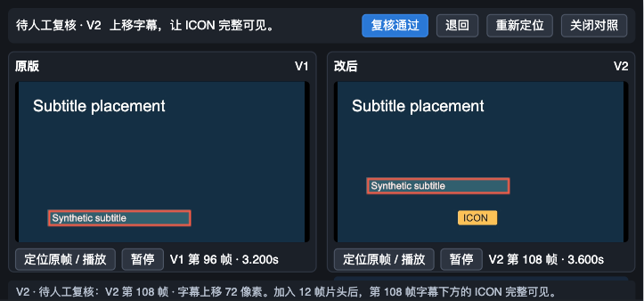

# 视频改稿与前后复核

[English](video-acceptance.en.md)

本示例使用两个独立的本机工程。每份审阅使用一种引擎、一个合成入口和一个绑定的接收会话。合成材料与依赖版本见[演示工程说明](../fixtures/video/README.md)。

## 开始审阅

将 `S` 设为已安装技能的 `scripts` 目录，`R` 设为新的本机审阅目录，`P` 设为工程根目录。每个演示使用独立的 `AE_HOME`，该演示的审阅服务与接收会话共用这个目录。

| 起点 | 操作 | 核对内容 |
| --- | --- | --- |
| 源工程 | 运行 `python3 "$S/video_engines.py" inspect "$P"`，再运行 `python3 "$S/build_viewer.py" --report "$P" --video-composition ENTRY --out "$R" --locale zh-CN`。 | 有多个候选时选定合成，缺片时由引擎渲染。复用已有成片时，先核对候选依据，再按提示用 `--reuse-movie PATH` 确认。 |
| MP4 | 运行 `python3 "$S/build_viewer.py" --report cut.mp4 --out "$R" --locale zh-CN`。 | 可以先写批注。需要改源时，在「关联源工程」填写引擎、根目录和入口，核对差异再确认。原批注仍可打开 V1。 |

运行 `python3 "$S/serve.py" "$R"` 打开本机对照页。在接收会话中用宿主支持的适配器绑定审阅。使用等待式接收时，将 `AE_HARNESS` 和 `AE_SESSION_ID` 设为当前宿主与稳定会话标识，再运行 `python3 "$S/wakeup.py" bind "$R" --adapter wait --harness "$AE_HARNESS" --session "$AE_SESSION_ID"`。同一会话负责领取和回执。

## 改稿与复核

1. 新增 5 条批注。在 30 fps 的第 96 帧框选字幕，将音乐区间标为第 120 至 179 帧（含两端），保存为 `[120,180)`，即第 4 至 6 秒。另写一条片头疑问和两条优先级较低的意见。
2. 在提交窗口只勾选字幕、音乐和片头疑问，填写批次附言。绑定的接收会话运行 `python3 "$S/notes.py" claim "$R"`，核对 3 个原批注 ID、定位、原片证据和附言。
3. 在工程源码中加 12 帧片头，上移字幕、调低音乐，再用同一引擎渲染 V2。回执 JSON 的 `notes` 数组逐条写入原 `noteId`。字幕使用 `"outcome":"fixed"`、改动说明和 `"target":{"kind":"frame","frame":108}`，音乐使用 `{"kind":"range","startFrame":132,"endFrame":192}`。第三条使用 `"outcome":"question"`，并在 `question` 写明疑问。
4. 运行 `python3 "$S/notes.py" video-receipt "$R" --review-id "$REVIEW_ID" --seq 1 --receipt-id demo-v2 --movie V2.mp4 --receipt v2.json`。此时应有 2 条待复核、1 条待答复、2 条未提交。渲染失败时，用单独的回执标识和 `--render-error REASON` 记录原因。修好后用新标识重试，先前登记的版本仍可播放。
5. 从原批注对照 V1 第 96 帧和 V2 第 108 帧，分别播放两个音乐片段。通过字幕，对音乐填写退回理由，并答复片头疑问。再次提交前先查看批次记录。只勾选退回的音乐，接收会话进一步降低音量、渲染 V3，并以原音乐批注 ID 和新批次号回执。从同一条可查到 V1 原话、V2 退回和 V3 改动。
6. 已删镜头返回 `deleted`、删除原因和带前后文的 `cut` 剪口。位置拿不准时返回 `needs_relocate` 并说明原因，由审阅人在页面校正。成组通过时，仅对确认当时证据齐全的已选条目生效。

## 2026-11-22 实测记录

两套工程均从 macOS 26.7.3（arm64）上的已安装技能启动，各使用一个独立的 Codex 接收会话、等待式绑定和专用台账。审阅页使用 Chrome 157.0.8103.79。

| 引擎 | 入口 | V1 RMS（dBFS） | V2 RMS（dBFS） | V3 RMS（dBFS） | 原音乐批注 ID |
| --- | --- | ---: | ---: | ---: | --- |
| Remotion 4.0.545 | `Demo` | −7.96 | −13.98 | −20.00 | `mwrmzafocs19iv` |
| HyperFrames 0.9.80 | `index.html` | −4.95 | −10.97 | −16.99 | `mwrmz2z75yqcfj` |

- **入口与渲染**。Remotion 列出 `Demo` 和 `Alternate`，选定 `Demo` 后渲染缺失的 V1。用同一工程再次构建时复用匹配成片，两份 V1 的字节一致。HyperFrames 先从缺片的工程入口渲染 V1，再以该 MP4 建立主审阅。页面保存 5 条批注后才确认源工程关联。两名接收方分别改源，并用各自工程的引擎渲染 V2 和 V3。HyperFrames 覆盖工程的常用输出后，审阅里的 V1 和 V2 哈希均与原档一致。
- **画面与声音**。两套工程均输出 640 × 360、30 fps 的 H.264 和 AAC 音轨，三版分别为 180、192、192 帧。浏览器对照了 V1 第 96 帧（3.2 秒）与 V2 第 108 帧（3.6 秒）。字幕上移 72 像素后，ICON 完整可见。两个工程各自的 V2、V3 全部解码画面哈希相同。Chrome 分别播放了前后片段并解码了未静音的音轨。表中数值是标记区间内 2 秒解码 PCM 的均方根电平。
- **领取与复核**。两个会话第一批各领取 5 条中的 3 条，页面均显示 2 条待复核、1 条待答复、2 条未提交。演示脚本通过页面上的审阅人控件通过字幕、退回音乐并答复片头。保存这些决定后仍只有 1 批。再次显式提交后，第二批只含原音乐批注和 V2 退回理由。V3 回执停在待复核，原音乐批注可回看 V1 定位、V2 退回和 V3 证据。
- **真人核验**。本次使用等待式接收，扬声器或耳机的真人试听、桌面私有 IPC 唤醒仍待验证。上述通过和退回均为合成用例约定的页面操作。

| 已登记 MP4 的 SHA-256 前缀 | V1 | V2 | V3 |
| --- | --- | --- | --- |
| Remotion | `42b154d54ba0` | `ea26fd4deba1` | `a729f459acf6` |
| HyperFrames | `04fe7099aabe` | `e74c3d1f6011` | `d6ded61de09d` |

本次本机证据保存在 `skill/annotation-everything-workspace/video-191-20261122/`。`remotion/measurements/summary.json` 与 `hyperframes/acceptance-summary.json` 可定位各版源码快照、成片、解码帧、2 秒 WAV 音频片段和回执。每个工程的 `v2-browser.json` 和 `v3-browser.json` 记录实际浏览器观测。其他机器可用演示生成器重新执行。
